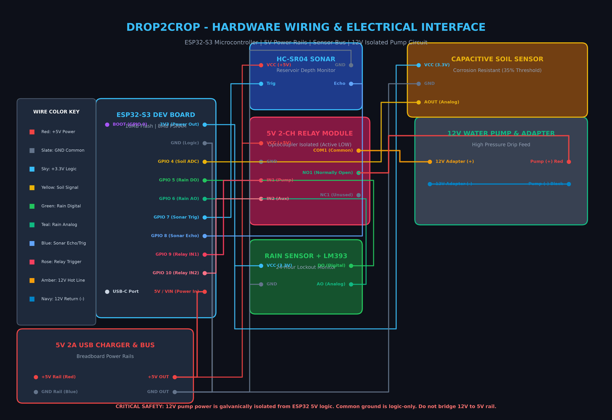

# Drop2Crop 🌾💧
### Precision Cloud IoT Irrigation & Fertigation Station

> **Drop2Crop** is a commercial-grade, zero-cost cloud irrigation system designed for precision agriculture in Bangladesh. It connects an **ESP32-S3** microcontroller in the field to a real-time, high-speed single-page web dashboard hosted on **GitHub Pages**, allowing farmers and operators to monitor soil moisture, reservoir levels, and rain status from anywhere in the country with sub-second latency.

---

## 🌐 Live Web Application
Access your farm's central station from any smartphone, tablet, or PC:
👉 **[Launch Drop2Crop Web Dashboard](https://fahimashabb.github.io/drop2crop/)**

---

## 📚 Official PDF Manuals & Documentation
Comprehensive, print-ready technical manuals are included in this repository:

| Manual Document | Description | Format |
|---|---|---|
| 📖 [**Drop2Crop User Manual**](docs/Drop2Crop_User_Manual.pdf) | Complete operational guide, mode selection, multi-timer scheduler, cloud dashboard controls, and troubleshooting. | `PDF (Printable)` |
| ⚡ [**Drop2Crop Wiring Diagram & Manual**](docs/Drop2Crop_Wiring_Diagram.pdf) | Full electrical schematic, breadboard rail distribution, 5V/12V isolation, and complete pinout tables. | `PDF (Printable)` |
| 🖼️ [**Master Wiring Schematic Graphic**](docs/drop2crop_wiring_schematic.png) | High-resolution color-coded visual wiring schematic. | `PNG (300 DPI)` |

---

## 🔌 Hardware Master Wiring Schematic

### Complete ESP32-S3 Pinout Mapping

| Component | Pin Label | ESP32-S3 Pin | Voltage | Notes |
|---|---|---|---|---|
| **Capacitive Soil Moisture** | VCC | `3V3` | 3.3V DC | Powers sensor directly from ESP32 clean 3.3V LDO regulator |
| | GND | `GND` | 0V | Common logic ground bus |
| | AOUT | `GPIO 4` | 0 – 3.3V | ADC1 Channel 3 (Calibrated: 1350 Wet / 3150 Dry) |
| **Raindrop Sensor (LM393)** | VCC | `3V3` | 3.3V DC | Powers comparator module at 3.3V logic level |
| | GND | `GND` | 0V | Common logic ground bus |
| | DO | `GPIO 5` | 3.3V Logic | Digital rain trigger (Active LOW: 0 = Rain detected) |
| | AO | `GPIO 6` | 0 – 3.3V | Analog precipitation density reading (ADC1_CH5) |
| **HC-SR04 Sonar** | VCC | `5V / VIN` | 5.0V DC | Powered from breadboard 5V power bus |
| | GND | `GND` | 0V | Common logic ground bus |
| | TRIG | `GPIO 7` | 3.3V Logic | 10µs ultrasonic transmitter pulse |
| | ECHO | `GPIO 8` | Input | Ultrasonic receiver pulse return width |
| **5V 2-Channel Relay** | VCC | `5V / VIN` | 5.0V DC | Powers coil circuitry (Breadboard 5V rail) |
| | GND | `GND` | 0V | Common logic ground bus |
| | IN1 | `GPIO 9` | Active LOW | Relay Channel 1: 12V Water Pump actuation |
| | IN2 | `GPIO 10` | Active LOW | Relay Channel 2: Aux / Fertigation solenoid |
| **Physical Onboard** | BOOT Button | `GPIO 0` | Active LOW | **Hold for 3 seconds** to force WiFi Captive Portal |

---

## ⚡ Power Supply & Electrical Isolation Architecture
To prevent inductive noise, electromagnetic interference (EMI), and voltage spikes from the water pump resetting the ESP32:

1. **Logic & Microcontroller Supply (5V):**
   - A standard **5V mobile phone charger (2A)** powers the ESP32-S3 via its USB-C port or by connecting +5V and GND directly to the breadboard power rails.
   - The ESP32 internal regulator steps 5V down to 3.3V on the `3V3` pin for the sensitive analog sensors.
2. **Actuator & Pump Supply (12V):**
   - The **12V Water Pump** is powered by an independent **12V Universal Power Adapter**.
   - **Galvanic Isolation:** The 12V positive (+) wire routes through Relay 1 `COM` (Common) and exits through `NO` (Normally Open) to the pump. The 12V negative (-) wire connects directly to the pump.
   - ⚠️ **NEVER connect the 12V supply to the ESP32 or breadboard logic rails.**

---

## 📶 Zero-Code WiFi Provisioning (Captive Portal)
If you move your Drop2Crop system to another location (e.g. from Rajshahi to Chittagong, or to a new field router), **you do not need a computer or firmware reprogramming**:

1. **Automatic Detection:** Upon boot, if the ESP32 cannot connect to the previously stored WiFi within 12 seconds, it automatically launches a temporary Wi-Fi Access Point:
   - **SSID:** `Drop2Crop_WiFi_Setup`
   - **Security:** Open
2. **Manual Force Reset:** At any time, press and hold the physical **BOOT button (GPIO 0)** on the ESP32 for **3 seconds**. The onboard LED will flash rapidly, wiping stale credentials and opening the portal.
3. **Connect Your Phone:**
   - On your smartphone or laptop, connect to `Drop2Crop_WiFi_Setup`.
   - The configuration portal will pop up automatically. If not, open your browser and go to `http://192.168.4.1`.
4. **Select Network & Save:**
   - The device automatically scans and displays all nearby 2.4 GHz networks.
   - Tap your network, enter the password, and click **Save & Connect**.
5. The ESP32 saves the credentials permanently in **Flash NVS** memory, reconnects to the cloud, synchronizes NTP time, and resumes autonomous irrigation.

> 💡 **Important:** The ESP32-S3 operates exclusively on **2.4 GHz Wi-Fi**. Always connect to a 2.4 GHz SSID.

---

## ⏰ Multi-Schedule Irrigation Engine
Drop2Crop features an onboard, clock-driven scheduling engine synchronized to **Bangladesh Standard Time (UTC+6)**:
- **Up to 10 Daily Slots:** Add, enable, disable, or delete timer slots directly from the cloud web dashboard.
- **Custom Times & Durations:** Set precise start times (e.g. `06:00 AM` for 20 minutes, `06:00 PM` for 40 minutes).
- **Flash Memory Persistence:** Schedules survive power outages and restarts.
- **Autonomous Local Execution:** Even if your farm's internet connection drops, the ESP32 internal clock continues to execute all scheduled watering cycles on time.
- **Smart Anti-Duplicate:** An internal `ranToday` latch ensures cycles run only once per day and resets automatically at midnight.

---

## 🌧️ 24-Hour Rain Lockout Protection
- When precipitation is detected on the rain sensor, the system immediately engages a **24-Hour (86,400-second) Lockout Cycle**.
- During this window, all automatic soil watering and timer cycles are locked out to prevent waterlogging and fungal infection.
- The web app displays a live countdown timer. A manual **"Override Lockout"** button is available if needed.

---

## 🚰 Ultrasonic Reservoir Level & Dry-Run Protection
- An ultrasonic transducer on top of the water tank measures water distance and calculates tank capacity (0% to 100%).
- **Low Water Warning (< 20%):** Web dashboard displays an amber warning alert to refill the reservoir.
- **Dry-Run Motor Protection (< 15%):** The firmware immediately cuts power to the pump relay to prevent impeller cavitation and motor burnout.

---

## 🎛️ Operational Modes

| Mode | Name | Description |
|:---:|---|---|
| **0** | **Smart Auto (Soil + Rain)** | Full autonomous closed-loop irrigation. Pumps when soil < 35%, stops at 70%. Subject to 24h rain lock and reservoir safety. |
| **1** | **Alert-Only Monitor** | Sends visual/audio alerts when soil < 35% without starting the pump. Farmer manually controls irrigation. |
| **2** | **Multi-Timer Schedule** | Irrigates strictly according to scheduled clock slots. Protected by rain lockout and dry-run safety. |
| **3** | **Manual Cloud Override** | Direct on-demand pump control from the cloud dashboard. |

---

## 🔐 Station Security & Access Control
To protect against unauthorized access and prevent anyone from controlling your irrigation motor:
- **Web Lockscreen Authentication:** When visiting the dashboard, an authentication lockscreen blocks unauthorized users from viewing controls or triggering actuators.
- **Hardware-Enforced Command Verification:** The ESP32-S3 firmware verifies an `"auth"` security token on every incoming command packet. If an unauthorized entity sends an MQTT command to your topic, the ESP32 firmware rejects it immediately (`[SECURITY ALERT] Unauthorized command rejected!`).
- **Default Factory PIN:** **`2564`** *(last 4 digits of device ID `drop2crop_2884858a2564`)*.
- **Change PIN in Settings:** Open Dashboard Settings (⚙️) to update your PIN. The update is securely saved to the ESP32's onboard Non-Volatile Flash Memory (NVS) and your browser.
- **One-Click Station Lock:** Click the **🔒 Lock** button in the top navigation bar at any time to lock down the interface.
- **Brute-Force Protection:** 5 failed attempts trigger a 30-second lockout timer with audio warning chimes.

---

## 🔌 Real-Time Device Online / Offline Detection
When you unplug the 5V mobile charger or power is removed from the ESP32:
- **Instant Cloud Detection:** A dual-layer MQTT Last Will & Testament (LWT) and a 6-second web watchdog continuously monitor the hardware's pulse.
- **Visual Alert Banner:** The dashboard changes from green to a prominent red **"The Device is Not Online (Turned Off)"** status pill and displays a top warning banner showing how long ago the device was last seen.
- **Safety Lock:** Cloud pump commands are safely locked when the device is offline to prevent confusion.

---

## 🩺 Hardware Verification & Diagnostic Guide
How to verify that your ESP32 is working properly when powered on:

1. **🔴 Red Power LED (Board Power Check):**
   - Connect the 5V charger. The solid red **PWR** LED on the ESP32 board should turn on immediately.
   - *If dark:* Check your USB-C cable or charger plug.
2. **📶 Wi-Fi "Proof of Life" Beacon (Zero-tool test):**
   - If the ESP32 is powered on but cannot reach your Wi-Fi within 12 seconds, it automatically broadcasts an open Wi-Fi network: **`Drop2Crop_WiFi_Setup`**.
   - If you see this network on your phone, **your ESP32 CPU, memory, and Wi-Fi radio are 100% healthy and working**.
3. **🌐 Web Dashboard Telemetry Stream:**
   - Once connected to your Wi-Fi, open **[Drop2Crop Web Dashboard](https://fahimashabb.github.io/drop2crop/)**.
   - The status pill will flip to a pulsing green **"Device Online"** badge, and sensor readings (soil moisture & water reservoir level) will stream in real time every 2 seconds.
4. **⚡ Relay Mechanical Click Test:**
   - On the web app, select **Mode 3 (Manual Cloud Override)** and click **"Start Pump"**.
   - You will hear an audible physical **"CLICK"** from the blue relay cube, and the channel 1 LED on the relay module will light up.

---

## 🛠️ Compiling & Uploading Firmware
If you wish to modify or flash the firmware manually:

1. Install [Arduino IDE](https://www.arduino.cc/en/software) or `arduino-cli`.
2. Add ESP32 Board Support:
   - Board URL: `https://espressif.github.io/arduino-esp32/package_esp32_index.json`
3. Install required libraries via Library Manager:
   - `PubSubClient` (Nick O'Leary)
   - `ArduinoJson` (Benoît Blanchon)
4. Select Board: **ESP32S3 Dev Module**.
5. Open `firmware/Drop2Crop_Firmware.ino`, select your COM port, and click **Upload**.

---

## 📄 License
This project is open-source under the [MIT License](LICENSE).
Built for high-efficiency precision farming in Bangladesh.
